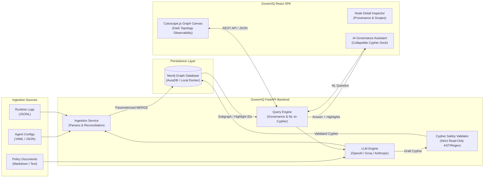
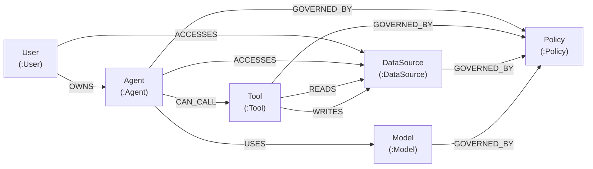
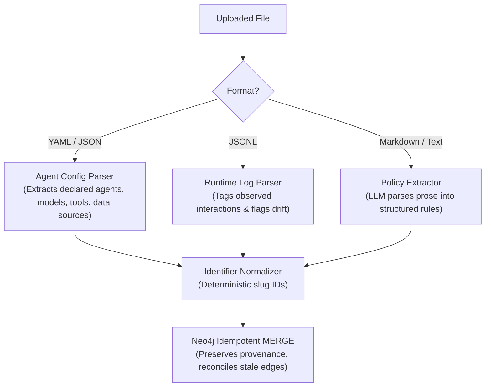

# GovernIQ — Governance Graph Builder

A unified governance graph that models **agents, models, tools, users, data sources, and policies** as connected nodes — making the full composition, runtime behavior, and compliance posture of any AI agent queryable, auditable, and visualizable in one place.

Modern AI agents are complex distributed compositions: foundation models, orchestration logic, autonomous tools, persistent memories, and the databases or APIs they can reach. In enterprise environments, these pieces typically reside in disconnected silos — models in an LLM registry, tools in code repositories, data in catalog services, and policies in legal wikis. When a tool is compromised or a compliance violation occurs, security teams struggle to reconstruct what was connected to what. 

**GovernIQ** unifies these facts into an auditable knowledge graph backed by Neo4j, answering critical governance questions, detecting config/runtime drift, calculating blast radius, and rendering interactive topology maps with natural-language AI querying.

---

## Table of Contents

- [Highlights](#highlights)
- [Architecture](#architecture)
- [Graph Data Model](#graph-data-model)
- [Tech Stack](#tech-stack)
- [Repository Layout](#repository-layout)
- [Getting Started](#getting-started)
- [Sample Data](#sample-data)
- [Governance Queries](#governance-queries)
- [Natural-Language Queries](#natural-language-queries)
- [API Reference](#api-reference)
- [Ingestion Pipeline](#ingestion-pipeline)
- [LLM Integration & Safety](#llm-integration--safety)
- [Configuration](#configuration)
- [Deployment](#deployment)
  - [Cloud: Vercel (Frontend) + Render (Backend) + Neo4j AuraDB](#cloud-vercel--render--neo4j-auradb)
  - [Containerized: Docker & AWS ECS](#containerized-docker--aws-ecs)
- [Quality Assurance & Verification](#quality-assurance--verification)
- [Success Criteria](#success-criteria)

---

## Highlights

- **Unified Governance Graph**: Captures six fundamental governance entities (`User`, `Agent`, `Model`, `Tool`, `DataSource`, `Policy`) and their typed relationships in Neo4j.
- **Three-Source Ingestion**:
  1. *Declarative Agent Configs* (YAML / JSON) — declared compositions and access scopes.
  2. *Runtime Execution Logs* (JSONL) — real-world observed invocations and data reads.
  3. *Unstructured Policy Documents* (Markdown / Prose) — natural-language rules parsed into structured policies by an LLM with deterministic heuristic fallback.
- **Transitive & Direct Access Analysis**: Evaluates direct access (`Agent -[:ACCESSES]-> DataSource`) as well as transitive access mediated through tools (`Agent -[:CAN_CALL]-> Tool -[:READS]-> DataSource`).
- **Blast-Radius Computation**: Given a compromised tool or data source, instantly traces every reachable agent, owning user, and downstream asset.
- **Config vs. Runtime Drift Detection**: Automatically highlights relationships observed at runtime but never declared in configuration.
- **Idempotent Reconciliation**: Re-ingesting an updated configuration reconciles the graph without data loss, removing stale declared edges and downgrading still-observed ones to runtime drift.
- **Natural-Language Cypher Assistant**: Security analysts can ask plain-English questions (*"Which tools can access the customer database?"*). The LLM translates the query into a read-only Cypher statement, executes it inside a read transaction, and visually highlights the matching subgraph.
- **Dark-Themed Observability Interface**: Built with React 18 and Cytoscape.js, featuring smooth physics layouts (`cose`, `breadthfirst`, `concentric`), floating inspection panels, and compact entity badges.
- **Production-Ready**: FastAPI async backend with connection pooling, structured logging, centralized exception envelopes, and dual deployment targets (Render + Vercel or Docker + AWS ECS).

---

## Architecture



---

## Graph Data Model

The graph models six core entity types with stable slug identifiers (`<type>:<normalized-name>`):



### Relationship Provenance & Drift
Every relationship can carry provenance flags:
- `declared: true` — Explicitly specified in the agent's structural configuration file.
- `observed: true` — Recorded during real-world runtime execution logs.

**Drift Condition**: When a relationship is `observed: true` but `declared: false`, GovernIQ flags it as **Runtime Drift** (e.g., an agent executing an undocumented tool call).

---

## Tech Stack

| Layer | Component | Technologies |
|---|---|---|
| **Frontend** | Application Shell & Canvas | React 18, TypeScript, Vite, Cytoscape.js |
| | State & UI | Tailwind CSS, Lucide React, Zustand, TanStack Query |
| | Validation | Zod (strict schema enforcement) |
| **Backend** | API Server | Python 3.11+, FastAPI, Uvicorn, Pydantic v2 |
| | Graph Driver | Neo4j Python Async Driver (`neo4j>=5.26.0`) |
| | Document Parsers | PyYAML, Python-Multipart, regex tokenizers |
| **Database** | Knowledge Graph | Neo4j 5.x (Local Docker or Neo4j AuraDB Free) |
| **AI / LLM** | Query & Policy Extraction | OpenAI-compatible API (Groq, OpenAI, Anthropic, or heuristic fallback) |
| **Deployments**| Cloud Native | Vercel (Frontend SPA) + Render (Backend Web Service) + AuraDB |
| | Containers | Docker, Docker Compose, AWS ECS / Terraform |

---

## Repository Layout

```text
GovernIQ/
├── backend/                       # FastAPI backend service
│   ├── app/
│   │   ├── api/                   # REST routers: health, documents, query, auth
│   │   ├── core/                  # Config, auth middleware, errors, logging
│   │   ├── graph/                 # Neo4j connection pool, schema constraints, repository
│   │   ├── llm/                   # LLM client, prompt templates, Cypher safety validator
│   │   ├── parsers/               # YAML/JSON, runtime logs, markdown prose extractors
│   │   └── services/              # Ingestion pipeline & query orchestration
│   ├── samples/                   # Sample test bundles
│   │   ├── simple/                # 1 of each entity, clean baseline
│   │   ├── medium/                # Shared model, policy reuse, intentional orphan agent
│   │   └── complex/               # Transitive access, drift, multi-agent mesh
│   ├── tests/                     # Pytest suite (70+ unit and integration tests)
│   ├── pyproject.toml             # Python build definition & dependencies
│   ├── requirements.txt           # Production locked requirements (Render-ready)
│   └── .env.example
├── frontend/                      # React 18 + Vite frontend SPA
│   ├── src/
│   │   ├── components/            # GraphCanvas, ChatBar, NodeDetailPanel, UploadZone
│   │   ├── lib/                   # API client, env configuration
│   │   ├── test/                  # Test setup & Vitest mocks
│   │   ├── types/                 # TypeScript interfaces and Zod schemas
│   │   ├── App.tsx                # Master workspace layout & state orchestration
│   │   └── index.css              # Custom styling, dark palette tokens, and scrollbars
│   ├── package.json
│   ├── vite.config.ts             # Vite bundler configuration & proxy
│   ├── vercel.json                # Vercel SPA rewrite routing configuration
│   └── .env.example
├── customer-support-agent.yaml    # Standalone demo configuration
├── render.yaml                    # Render Blueprint Infrastructure-as-Code
├── FRONTEND.md                    # Detailed frontend architecture document
└── README.md
```

---

## Getting Started

### Prerequisites
- **Python 3.11+**
- **Node.js 18+** & **npm**
- **Neo4j** (either a free [Neo4j AuraDB](https://console.neo4j.io) instance or local Docker)

---

### 1. Backend Setup

```bash
cd backend

# Create and activate virtual environment
python -m venv .venv
# Windows PowerShell:
.\.venv\Scripts\activate
# macOS/Linux:
# source .venv/bin/activate

# Install dependencies
pip install -r requirements.txt
pip install -e ".[dev]"

# Configure environment
cp .env.example .env
```

Ensure your `.env` contains valid Neo4j credentials and your LLM key:
```env
API_KEY=dev-secret-key-12345
NEO4J_URI=bolt://localhost:7687     # or neo4j+s://<db>.databases.neo4j.io
NEO4J_USER=neo4j
NEO4J_PASSWORD=password
LLM_PROVIDER=groq
LLM_API_KEY=gsk_your_groq_key
LLM_MODEL=openai/gpt-oss-120b
```

Run the FastAPI development server:
```bash
uvicorn app.main:app --reload --port 8000
```
Verify backend health: `http://localhost:8000/api/health` → `{"status": "ok"}`.

---

### 2. Frontend Setup

```bash
cd frontend

# Install dependencies
npm install

# Configure environment
cp .env.example .env
```

Ensure `frontend/.env` points to your backend:
```env
VITE_API_URL=http://localhost:8000
VITE_API_KEY=dev-secret-key-12345
```

Start the Vite development server:
```bash
npm run dev
```
Open **http://localhost:5173** in your browser.

---

## Sample Data

Three sample bundles are included in [`backend/samples/`](backend/samples/) to exercise different governance scenarios:

| Bundle | What It Exercises |
|---|---|
| **`simple`** | Baseline setup containing one of each entity type; verified zero orphans. |
| **`medium`** | Multi-agent fleet sharing a single foundation model, one shared policy, and **one intentional orphan agent** (no attached policy). |
| **`complex`** | Multi-hop transitive access, overlapping policies, multiple users, and **runtime drift** (a tool invoked in runtime logs that was never declared in config). |
| **`customer-support-agent.yaml`** | Standalone production agent with multiple tools, policies, CRM databases, and knowledge bases. |

To ingest a sample, simply drag and drop the `.yaml`, `.json`, `.jsonl`, or `.md` file directly onto the GovernIQ graph canvas.

---

## Governance Queries

GovernIQ answers key enterprise compliance questions via both natural language and specialized Cypher patterns:

1. **Direct & Transitive Data Access**:
   - *"Which agents can read or write to the Customer DB?"*
   - Returns agents with direct access AND agents holding tools with read/write access.
2. **Orphan Agent Audit**:
   - *"Find all agents with no governing policy attached."*
   - Detects agents that lack a `GOVERNED_BY` relationship to any `Policy` node.
3. **Model Dependency Mapping**:
   - *"Which agents are using Claude or GPT-4o?"*
   - Identifies model exposure and version fragmentation across agent fleets.
4. **Blast-Radius Analysis**:
   - *"What is the blast radius of a compromised tool?"*
   - Traces the compromised tool upward to calling agents, outward to owning users, and downward to connected data sources.
5. **Runtime Drift Detection**:
   - *"Where does runtime tool usage diverge from declared config?"*
   - Returns edges with `observed: true` and `declared: false`.

---

## Natural-Language Queries

The bottom floating **AI Governance Assistant** lets you query the graph using plain English.

```text
User Question: "Which agents can access the customer database?"
           │
           ▼
[LLM Engine] ───> Generates read-only Cypher grounded by fixed schema
           │
           ▼
[Safety Validator] ───> Rejects write operations / procedures (CREATE, MERGE, SET, DELETE, DROP)
           │
           ▼
[Neo4j Read Driver] ───> Executes query in READ transaction with timeout
           │
           ▼
[Graph Canvas] ───> Highlights matched nodes & edges, displays formatted Cypher in dock
```

### Safety & Resilience
- **Strict Read-Only Enforcement**: Statically rejects queries with mutating keywords (`CREATE`, `MERGE`, `DELETE`, `SET`, `REMOVE`, `DROP`, `ALTER`, `CALL dbms`).
- **Transaction Protection**: All queries run against Neo4j read sessions (`neo4j.AccessMode.READ`).
- **Graceful Fallback**: If offline or if the LLM provider is unreachable, an in-memory heuristic extractor answers standard governance questions.

---

## API Reference

All protected endpoints require the header `X-API-Key: <your-key>`.

| Method | Endpoint | Description |
|---|---|---|
| `GET` | `/api/health` | Public liveness probe (returns `{"status":"ok"}`) |
| `POST`| `/api/documents` | Upload and ingest a governance document (YAML, JSON, JSONL, MD) |
| `GET` | `/api/documents` | List summaries of all ingested document sources |
| `GET` | `/api/graph` | Retrieve full graph snapshot (all nodes and edges with counts) |
| `GET` | `/api/graph/nodes/{node_id}` | Retrieve node properties and immediate incoming/outgoing neighbors |
| `DELETE`| `/api/graph` | Wipe all nodes and edges from the graph database |
| `GET` | `/api/models` | Retrieve available LLM models for query processing |
| `POST`| `/api/query` | Translate question to Cypher, execute, and return visual highlight IDs |

Interactive OpenAPI documentation is available at **http://localhost:8000/docs**.

---

## Ingestion Pipeline

The ingestion pipeline unifies three heterogeneous formats into a standardized graph:



---

## LLM Integration & Safety

GovernIQ features a provider-agnostic LLM interface configured via environment variables:

- **Groq** (Default for high-speed inference with models like `openai/gpt-oss-120b` or `llama-3.3-70b-versatile`).
- **OpenAI** (`gpt-4o`, `gpt-4o-mini`).
- **Anthropic** (`claude-3-5-sonnet`).
- **Heuristic Fallback Engine**: If no LLM credentials are provided, GovernIQ utilizes structural token matching to extract policies and resolve core queries locally.

---

## Configuration

| Variable | Default | Purpose |
|---|---|---|
| `API_KEY` | `dev-secret-key-12345` | Secret shared between frontend and backend |
| `HOST` / `PORT` | `0.0.0.0` / `8000` | Host and port binding for FastAPI |
| `CORS_ORIGINS` | `http://localhost:5173,...` | Comma-separated list of allowed browser origins |
| `NEO4J_URI` | `bolt://localhost:7687` | Bolt connection string to Neo4j instance |
| `NEO4J_USER` | `neo4j` | Database user account |
| `NEO4J_PASSWORD` | `password` | Database password |
| `NEO4J_DATABASE` | `neo4j` | Database name |
| `LLM_PROVIDER` | `groq` | Active LLM provider (`groq`, `openai`, `anthropic`, `llm`) |
| `LLM_API_KEY` | `""` | API key for the LLM provider |
| `LLM_MODEL` | `openai/gpt-oss-120b` | Target LLM model identifier |
| `VITE_API_URL` | `http://localhost:8000` | Frontend setting pointing to backend URL |
| `VITE_API_KEY` | `dev-secret-key-12345` | Frontend setting passed as `X-API-Key` |

---

## Deployment

### Cloud: Vercel + Render + Neo4j AuraDB

GovernIQ is optimized for decoupled cloud hosting:

#### 1. Neo4j AuraDB (Cloud Graph Database)
- Create a free instance at [console.neo4j.io](https://console.neo4j.io).
- Save your connection URI (`neo4j+s://...`) and password.

#### 2. Render (Backend FastAPI Service)
- Create a new **Web Service** on [Render](https://dashboard.render.com).
- Root Directory: `backend`
- Build Command: `pip install -r requirements.txt`
- Start Command: `uvicorn app.main:app --host 0.0.0.0 --port $PORT`
- Set Environment Variables: `API_KEY`, `NEO4J_URI`, `NEO4J_USER`, `NEO4J_PASSWORD`, `LLM_PROVIDER`, `LLM_API_KEY`, `CORS_ORIGINS` (*add your Vercel domain*).

#### 3. Vercel (Frontend React SPA)
- Import repository on [Vercel](https://vercel.com).
- Framework Preset: `Vite`
- Root Directory: `frontend`
- Set Environment Variables:
  - `VITE_API_URL` = `https://your-backend.onrender.com`
  - `VITE_API_KEY` = `<matching-API_KEY>`
- Deploy. [`frontend/vercel.json`](frontend/vercel.json) automatically handles SPA routes.

---

### Containerized: Docker & AWS ECS

To run the complete stack locally using Docker:

```bash
# Start local Neo4j container
docker run -d --name governiq-neo4j \
  -p 7474:7474 -p 7687:7687 \
  -e NEO4J_AUTH=neo4j/password \
  neo4j:5.26-community
```

For AWS enterprise deployment, the repository includes Terraform modules for provisioning an Application Load Balancer, ECS Fargate tasks, AWS Secrets Manager for credentials, and VPC networking.

---

## Quality Assurance & Verification

Both frontend and backend include comprehensive test suites:

### Backend Testing
```bash
cd backend
pytest -v
ruff check .
mypy app
```

### Frontend Testing
```bash
cd frontend
npm test          # Runs 21 Vitest integration tests in jsdom
npm run typecheck # Full TypeScript validation
npm run build     # Production bundle verification
```

---

## Success Criteria

- [x] **Six-Node Domain Model**: Complete representation of `User`, `Agent`, `Model`, `Tool`, `DataSource`, and `Policy`.
- [x] **Multi-Source Ingestion**: Ingests declarative YAML/JSON configs, JSONL runtime logs, and Markdown prose policies.
- [x] **Deterministic ID Merging**: Generates consistent slug IDs avoiding duplicate nodes on re-upload.
- [x] **Governance Cypher Queries**: Direct and transitive access paths, model dependencies, and orphan agent detection.
- [x] **Blast-Radius Analysis**: Evaluates upstream agent impact and downstream exposed data sources for compromised tools.
- [x] **Config vs. Runtime Drift**: Distinguishes `declared` vs `observed` states.
- [x] **Safe NL-to-Cypher**: LLM translation with static read-only validation and read transactions.
- [x] **Interactive Observability UI**: Full Cytoscape canvas with dark enterprise aesthetic, collapsible chat dock, and node inspector.
- [x] **Turnkey Cloud Deployment**: Verified compatibility with Vercel and Render with zero build errors.
